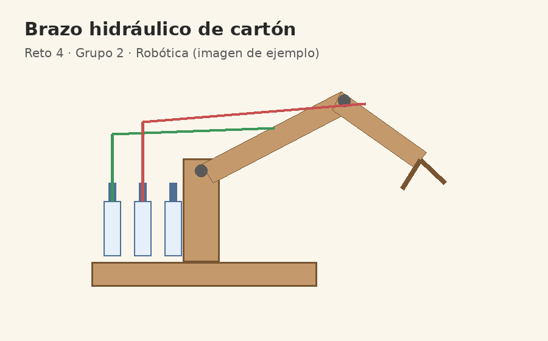

# Reto 4 · Registro del Show and Tell

**Grupo 2 · Robótica** · Responsable de entrega: @usuario-ejemplo

## Participantes y roles

- @usuario-1: facilitación
- @usuario-2: documentación
- @usuario-3: construcción

## Lo que mostramos

| Prototipo | Materiales | Aprendizaje |
|---|---|---|
| Brazo hidráulico | Cartón y jeringas | La presión se entiende tocando |
| Seguidor de línea | Sensores reciclados | Probar en el piso real |

## Enlaces

[Guía de Markdown de GitHub](https://docs.github.com/es/get-started/writing-on-github)

## Foto del prototipo

